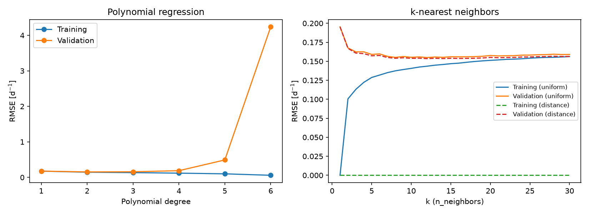
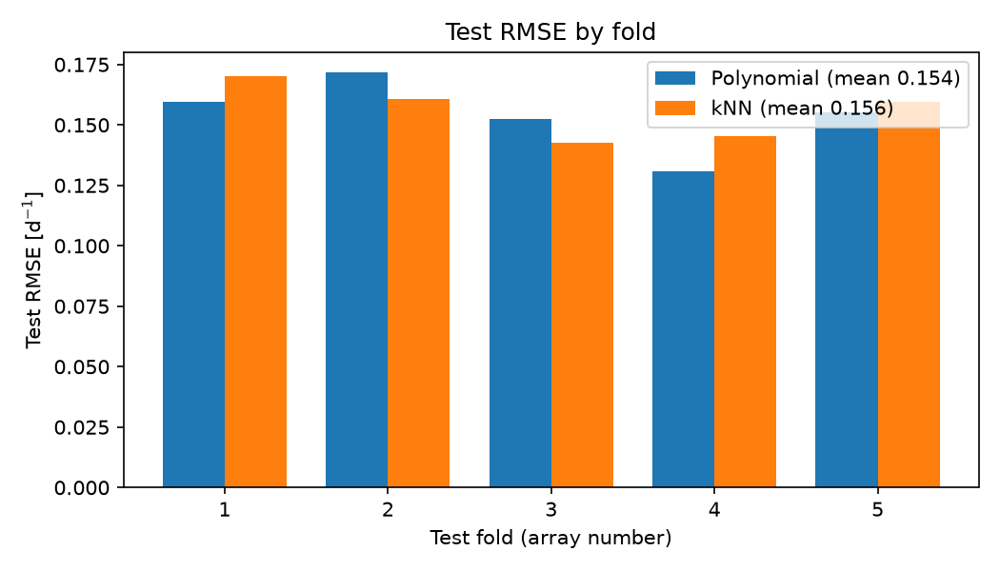
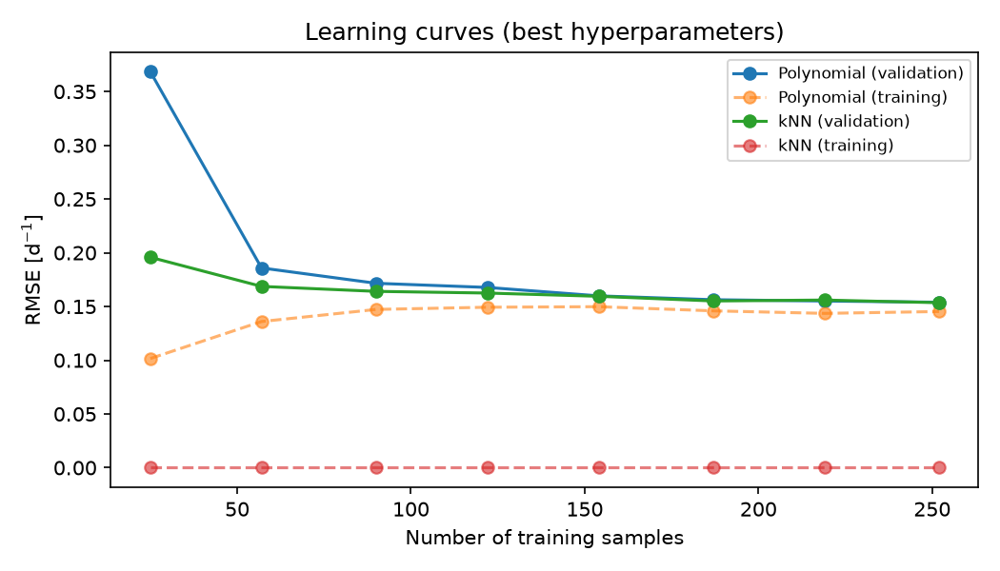
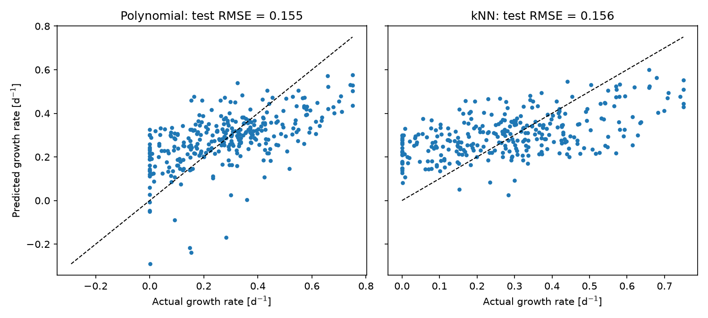
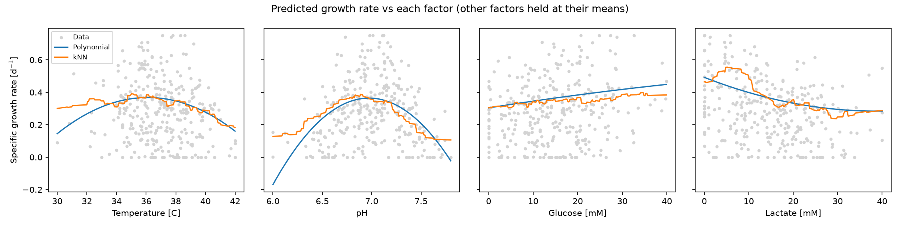

# Cell Growth Rate Prediction with Machine Learning

This project predicts the specific growth rate of a cell culture from four process variables: temperature, pH, glucose
concentration, and lactate concentration. Growth rate cannot be set directly, so bioprocess engineers need to know
which operating conditions drive it up or down. The program compares polynomial and *k*-nearest neighbors regression,
tunes and validates both, and explains how each variable shapes cell growth.

## Highlights

- Built a nested cross-validation pipeline with scikit-learn
- Tuned polynomial degree and neighbor count via grid search
- Benchmarked polynomial regression against *k*-nearest neighbors models
- Visualized validation, learning, parity, and partial dependence curves
- Interpreted standardized coefficients to explain growth rate drivers

## Environment

- Python 3.14.7
- matplotlib 3.11.0
- numpy 2.5.2
- pandas 3.0.5
- scikit-learn 1.9.0

## Code Design

### Data Loading and Splitting

The program begins by reading the cell culture dataset from `datasets/` into a pandas DataFrame. The first column,
specific growth rate, is the prediction target, and the remaining four columns are the input features. The 318 rows are
divided into five equal arrays of 63 samples each; the three leftover rows are set aside so that every array is the same
size. Equal arrays matter because each one later serves as a test set, and equally sized test sets make the error from
each fold directly comparable. This stage turns a raw file into a structure the rest of the workflow can rotate through.

### Candidate Models and Hyperparameter Grids

Next, two candidate models are defined as scikit-learn pipelines. The polynomial pipeline standardizes the features,
expands them into polynomial and interaction terms, and fits an ordinary least squares regression. The *k*-nearest
neighbors pipeline standardizes the features and then averages the growth rates of nearby samples. Each model is paired
with a grid of hyperparameters to search: polynomial degrees 1 to 6, and neighbor counts from 1 to 30 with either
uniform or distance weighting.

Standardization is essential for both models. The features have very different scales (temperature varies by about
12 °C while glucose varies by about 40 mM), so without scaling, *k*-nearest neighbors distances would be dominated by
the concentrations, and the polynomial coefficients could not be compared with each other. Placing the scaler inside the
pipeline means it is refit on training data only, which prevents information from the test data leaking into the model.

### Nested Cross-Validation

This stage produces the main evidence for choosing a model. Each of the five arrays takes one turn as the test set while
the other four (252 samples) are used for training. Within the training data, a grid search with its own shuffled
5-fold cross-validation picks the best hyperparameters for each model. The tuned model is then scored once on the
untouched test array, recording the training error, test RMSE, and test R².

Nesting the hyperparameter search inside the outer loop is what makes the comparison fair. If hyperparameters were
chosen using the same data that measured performance, the reported error would be optimistic. The per-fold results are
printed, plotted as a bar chart, and exported to `tables/cv_results_by_fold.csv`, with averages in
`tables/cv_summary.csv`.

### Final Tuning and Validation Curves

Once the comparison is complete, both grid searches are rerun on all 315 samples to produce a final model of each type.
Training and validation RMSE are recorded for every hyperparameter value and plotted as validation curves, which show
where each model moves from underfitting to overfitting. The same results are saved to
`tables/validation_polynomial.csv` and `tables/validation_knn.csv`. This stage justifies the specific hyperparameter
values rather than just reporting the winner.

### Learning Curves

The program then trains each final model on increasing fractions of the data and records its error. Learning curves
answer a practical question: would collecting more experimental runs improve the model? If validation error is still
falling at the full dataset size, more data would help; if it has levelled off, the remaining error comes from noise or
from factors not captured by the four inputs.

### Interpretation

The final stage turns the fitted models into process knowledge. The polynomial coefficients, which are on standardized
features and therefore comparable in magnitude, are printed and saved to `tables/polynomial_coefficients.csv`. Partial
dependence plots vary one factor at a time while holding the others at their mean values, showing the shape of each
variable's effect for both models. The polynomial model is also evaluated over a 25 × 25 × 25 × 25 grid spanning the
observed range of every factor, and the conditions giving the highest and lowest predicted growth rates are exported to
`tables/predicted_extreme_conditions.csv`. Finally, a parity plot compares predicted and actual growth rates for every
test prediction from the outer cross-validation, revealing any systematic bias that a single error number would hide.
All figures are written to `figures/` and all tables to `tables/`.

## Analysis

### Modelling Approach

The dataset contains 318 cell cultures with four inputs and one output. Two families of regression model were
considered: polynomial regression, which assumes the response is a smooth function of the inputs, and *k*-nearest
neighbors regression, which makes no assumption about shape and instead predicts from similar past cultures. Both were
tuned and assessed with the same nested cross-validation so that their test errors can be compared directly. Model
quality is reported as root mean squared error (RMSE) in d⁻¹, alongside R². As a reference point, the standard deviation
of the growth rate is 0.188 d⁻¹, which is roughly the RMSE of a model that always predicts the mean.

### Choosing the Polynomial Degree

The validation curve shows a clear optimum at degree 2.

| Polynomial Degree | Mean Train RMSE [d⁻¹] | Mean Validation RMSE [d⁻¹] |
|-------------------|-----------------------|----------------------------|
| 1                 | 0.1753                | 0.1761                     |
| 2                 | 0.1453                | 0.1539                     |
| 3                 | 0.1341                | 0.1577                     |
| 4                 | 0.1190                | 0.1888                     |
| 5                 | 0.0998                | 0.4905                     |
| 6                 | 0.0591                | 4.2376                     |

A linear model (degree 1) underfits: training and validation errors are both high and almost identical, meaning the
model is too simple to capture the curvature in the data. Moving to degree 2 lowers validation error by 13%, because
quadratic terms allow a growth rate that peaks at an intermediate temperature or pH. Beyond degree 2, training error
keeps falling but validation error rises. At degree 3 the gap is modest, but by degree 5 and 6 the model has 125 and 209
terms for only 252 training samples, and the validation error explodes. Degree 2 sits at the bottom of the validation
curve with only 14 terms, and the grid search selected it independently in all five outer folds. That consistency is
strong evidence that degree 2 is the right complexity for this data, not a lucky choice for one particular split.

### The *k*-Nearest Neighbors Alternative

For *k*-nearest neighbors, a single neighbor (*k* = 1) overfits badly, with a validation RMSE of 0.195 d⁻¹, worse than
predicting the mean. Validation error falls quickly as *k* increases and reaches a broad, flat minimum of about
0.154 d⁻¹ between *k* = 10 and *k* = 16, then rises slowly as averaging over too many neighbors blurs real trends.
Distance weighting was preferred over uniform weighting at almost every *k*, though the difference is small (about
0.002 d⁻¹). Note that distance weighting always gives a training RMSE of zero, because each training point is its own
closest neighbor with infinite weight. Training error is therefore not a useful overfitting diagnostic for this model,
and only the validation error should be trusted.

### Head-to-Head Comparison

| Model                   | Mean Test RMSE [d⁻¹] | SD Test RMSE [d⁻¹] | Mean Test R² | Selected Hyperparameters           |
|-------------------------|----------------------|--------------------|--------------|------------------------------------|
| Polynomial              | 0.1540               | 0.0132             | 0.296        | Degree 2 (all 5 folds)             |
| *k*-Nearest Neighbors   | 0.1557               | 0.0103             | 0.289        | *k* = 7 to 15, distance (by fold)  |

The two models perform almost identically on unseen data; the 0.002 d⁻¹ difference in mean RMSE is far smaller than
the fold-to-fold variation. The polynomial has the lower error in three of the five folds and *k*-nearest neighbors in the other two. The learning
curves show the same picture: both models converge to about 0.155 d⁻¹ once around 150 training samples are available.

### Why the Degree-2 Polynomial Was Selected

Since accuracy does not separate the two models, the choice rests on other qualities, all of which favor the
polynomial:

- **Stability.** The polynomial chose degree 2 in every fold, while the best *k* jumped between 7 and 15. A model whose
  configuration does not change when the data changes is easier to trust.
- **Interpretability.** The polynomial is an explicit equation. Its standardized coefficients show which factors matter
  and in which direction, which a *k*-nearest neighbors model cannot provide.
- **Smoothness.** The partial dependence plots show the *k*-nearest neighbors predictions as jagged steps, while real
  cell growth responds smoothly to temperature and pH. The polynomial's smooth curves are more physically plausible.
- **Simplicity.** The model is 15 numbers; *k*-nearest neighbors must store the full training set to make a prediction.

### Advantages and Limitations

The selected model's main advantages are that it is fast, transparent, and stable, and its predictions are as accurate
as a more flexible alternative. Its quadratic form naturally represents an optimum, which matches how temperature and pH
are known to affect cells.

Its limitations are significant. An R² of about 0.30 means the four inputs explain less than a third of the variation in
growth rate. Since the learning curves have flattened, more data alone will not fix this; the remaining variation likely
comes from measurement noise or from factors outside the dataset, such as dissolved oxygen, cell line, or culture age.
The parity plot shows that the model compresses its predictions toward the mean: it underpredicts the fastest-growing
cultures (above about 0.5 d⁻¹) and overpredicts slow ones. Most importantly, a polynomial has no lower bound, so it can
predict negative growth rates, which are physically impossible. Several test predictions fall below zero, down to about
−0.3 d⁻¹, even though no observed growth rate is negative.

### Effect of Each Process Variable

| Term (standardized)   | Coefficient |
|-----------------------|-------------|
| pH²                   | −0.0646     |
| Lactate               | −0.0614     |
| Glucose               | +0.0332     |
| Temperature²          | −0.0246     |
| Temperature           | −0.0197     |
| Glucose × Lactate     | −0.0188     |
| Temperature × pH      | −0.0187     |

*The seven largest of 14 terms; see `tables/polynomial_coefficients.csv` for all of them.*

- **pH** has the strongest effect, but it is entirely nonlinear. Its linear correlation with growth rate is only 0.01,
  yet the pH² term is the largest coefficient. Growth peaks near pH 7.0 and falls steeply in both directions, which a
  linear model would completely miss.
- **Lactate** is the strongest linear factor. Growth falls steadily as lactate accumulates, consistent with lactate
  being an inhibitory byproduct of metabolism.
- **Glucose** increases growth rate, as expected for the main carbon source, with no sign of saturation over the
  observed range. The negative glucose × lactate interaction means high lactate reduces the benefit of extra glucose.
- **Temperature** has an optimum near 36 °C, with growth declining by more than half at both 30 °C and 42 °C.

### Conditions for High Growth Rate

The highest predicted growth rates, about 0.68 d⁻¹, occur at 35 to 35.5 °C, pH 6.9 to 7.0, high glucose (about 40 mM),
and no lactate. In practice, this describes an early-stage, well-fed culture held near its physiological temperature
and neutral pH.

### Conditions for Low Growth Rate

Growth is lowest when conditions move away from their optima at the same time: low temperature (near 30 °C), acidic
pH (near 6.0), depleted glucose, and lactate above about 20 mM. This resembles a late-stage culture that has consumed
its glucose and acidified its medium through lactate production. Low pH and high lactate are often linked in practice,
so these two stresses tend to compound each other.

### Where Predictions Are Unreliable

- **Combined extremes.** At the corner described above, the model predicts about −0.74 d⁻¹. This is physically
  impossible, and it happens because few or no cultures in the data combine several extreme values at once. Growth
  there is likely near zero, but the polynomial curve keeps falling.
- **Edges of the pH range.** Near pH 6.2 and 7.8, the quadratic curve drops to zero and below, while *k*-nearest
  neighbors levels off around 0.1 d⁻¹, so the two models disagree strongly.
- **Outside the training range.** The model has never seen temperatures outside 30 to 42 °C, pH outside 6.0 to 7.8, or
  concentrations above 40 mM, so any prediction there is extrapolation.
- **Very fast or very slow growth.** Because predictions are pulled toward the mean, growth rates above about
  0.5 d⁻¹ or near zero are less accurate than mid-range ones.

### Applications

The model is best suited to screening and process design rather than exact prediction. Engineers could use it to
choose temperature and pH setpoints before running experiments, to estimate how much growth will slow as lactate
accumulates, and to decide when to feed glucose or adjust pH during a fed-batch run. Because its equation is explicit,
it could also be embedded in a monitoring system that flags a culture whose measured conditions predict a drop in
growth. For each use, predictions should be clipped at zero and limited to the range of conditions covered by the
training data, and the model should be retrained as more cultures, and possibly more process variables, become
available.
